# Game of Life — composed wallpapers

A macOS screen saver of hand-composed scenes from Conway's Game of Life.
Nothing is random soup: each scene places well-known patterns (glider guns,
spaceships, oscillators, methuselahs, eaters, switch engines) on purpose and
lets them tell a short story, in colour, on a black background.

The rules are the real B3/S23 rules; colour is decoration on top. Each pattern
is placed with a colour, and a newborn cell takes the majority colour of its
three parents. So you can always see whose debris is whose, and where two
fires meet.

## The scenes

<table>
<tr>
<td width="50%">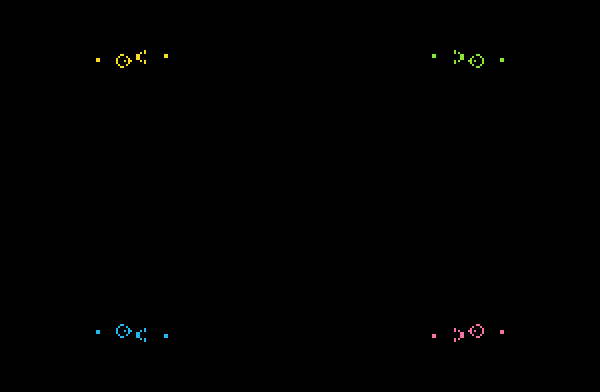<br>
<b>Crossfire</b>: four Gosper guns in the corners aim at the centre. Their
streams graze each other, set off a symmetric fire, and it slowly eats the
guns.</td>
<td width="50%">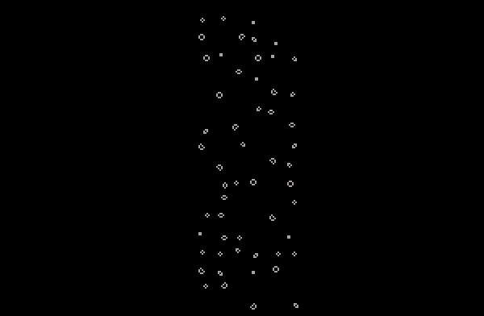<br>
<b>Armada</b>: a V of spaceships behind a gold flagship flies into an asteroid
belt of still lifes. A pink squadron comes from the other side and slow
copperheads follow. The wreckage burns orange.</td>
</tr>
<tr>
<td>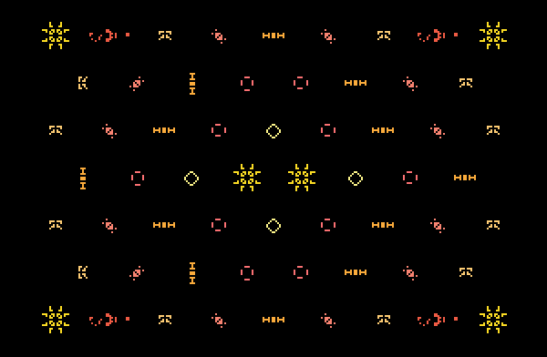<br>
<b>Lantern Garden</b>: concentric diamonds of oscillators glow like paper
lanterns. After a calm minute and a half, stray gliders drift in and the garden
catches fire.</td>
<td>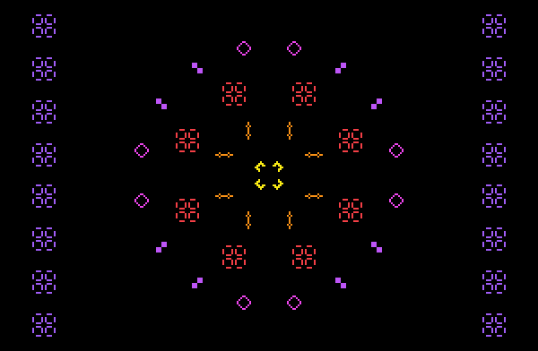<br>
<b>Supernova</b>: an 8-fold mandala of pentadecathlons, pulsars and octagons
around a B-heptomino core. The core explodes and eats ring after ring, staying
perfectly symmetric.</td>
</tr>
<tr>
<td>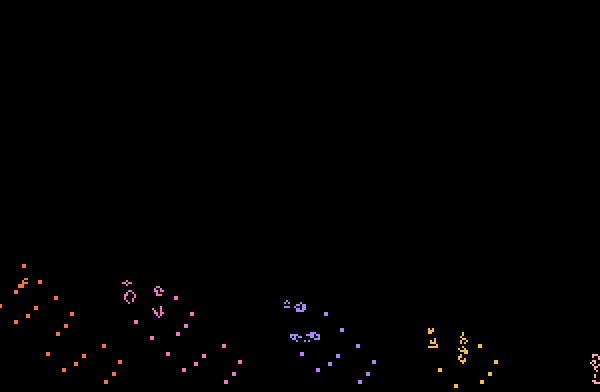<br>
<b>Contrails</b>: block-laying switch engines climb from below the horizon like
jets at sunset, each drawing a dotted trail of blocks.</td>
<td>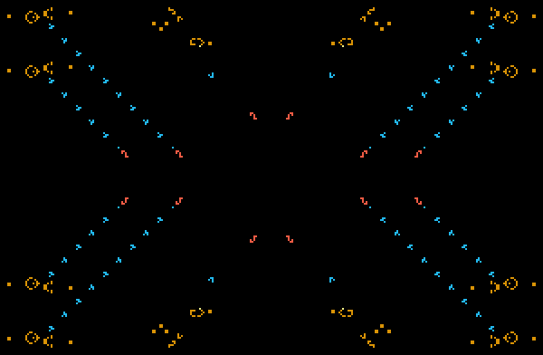<br>
<b>Clockwork</b>: a circuit board of glider guns, with every stream ending in
an eater: copper guns, cyan lanes, red eaters. Two minutes in, one eater
disappears and the factory collapses.</td>
</tr>
<tr>
<td>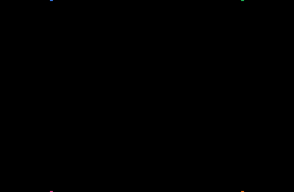<br>
<b>Big Bang</b>: waves of spaceships and gliders from all eight compass points,
one colour each, timed to meet at the centre in a rainbow firework.</td>
<td>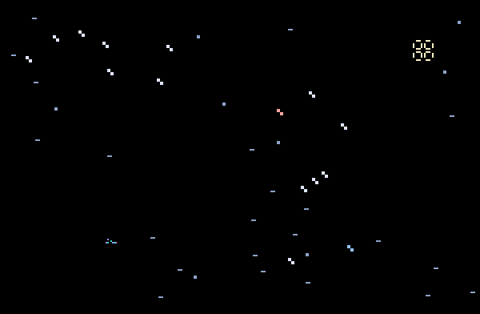<br>
<b>Night Sky</b>: the Big Dipper and Orion (red Betelgeuse, blue Rigel) in
twinkling oscillators, a pulsar moon, shooting stars, and an acorn nebula
blooming in the corner.</td>
</tr>
<tr>
<td>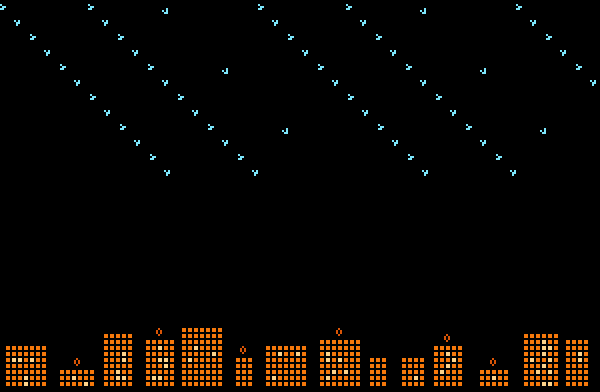<br>
<b>Monsoon</b>: guns hidden above the screen send slanted glider rain onto a
skyline with lit windows. Eater lightning rods absorb some lanes; the rest
sets the city on fire.</td>
<td>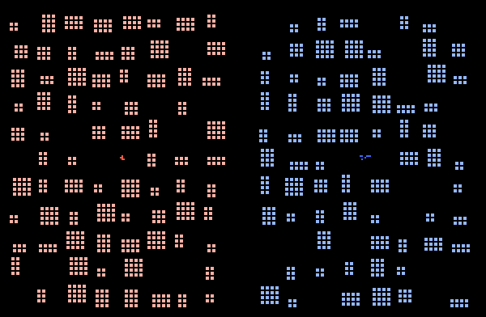<br>
<b>Two Kingdoms</b>: red and blue cities of block fortresses, each with a
methuselah king in its plaza. Both fires spread, and they meet at a violet
front line.</td>
</tr>
<tr>
<td>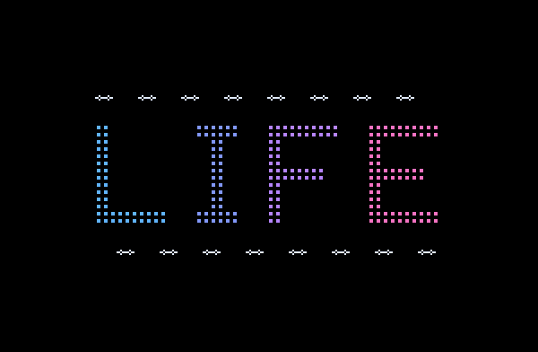<br>
<b>LIFE</b>: the word in dotted block letters between rows of
pentadecathlons. The letters catch fire one at a time.</td>
<td></td>
</tr>
</table>

The GIFs are time-lapses (4–12 generations per frame) at 300×196 cells. The
screen saver runs at 15 generations per second, with cells cross-fading between
generations, and lasts 2–7 minutes per scene. Scenes play in a shuffled loop.
Each showing varies a little: the layout may be mirrored and the hues shift.

## Install

Requires macOS 14 or later and the Xcode command line tools (`xcode-select --install`).

```sh
./build.sh --install
```

Then choose **Game of Life** in System Settings › Screen Saver.

## How it works

| File | What's in it |
|---|---|
| `Sources/Life.swift` | `LifeWorld`: the B3/S23 stepper, colour inheritance, stagnation detection, and an absorbing border that deletes objects which have flown off-screen |
| `Sources/Patterns.swift` | The pattern library (RLE parser, orientations, about 30 patterns) |
| `Sources/Stage.swift` | `Stage`, the toolkit a scene is composed with, and the `Scene` type |
| `Sources/Scenes.swift` | The scenes themselves |
| `Sources/GameOfLifeView.swift` | The screen saver: playlist, rendering, fades |
| `Tools/explore/main.swift` | Offline tool: self-tests, contact sheets and the GIFs above |

The world is the screen plus a hidden 64-cell margin on every side. Scenes
launch ships and hide guns there, and anything that flies out is deleted
cleanly instead of wrapping around.

## Contributing a scene

New scenes are very welcome. A scene is one `static let` in `Sources/Scenes.swift`:

```swift
/// One line on what happens.
static let myScene = Scene(
    name: "My Scene",
    palette: [0, 0x22D3EE, 0xF472B6, 0xFFFFFF],   // 0xRRGGBB; index 0 is the background
    mixColor: 3,                                  // newborn whose three parents all differ
    generations: 4000, stagnationAfter: 800       // run length; may end early only after this
) { s in
    // Coordinates are screen cells: (0, 0) top left, s.W × s.H in size.
    s.center(Patterns.pulsar, s.cx, s.cy, .identity, 1)
    s.ship(Patterns.lwss, .e, -10, s.y(0.3), 2)     // launched from the hidden margin
    s.gun(.gosper, 10, 10, eater: 20, gunColor: 1, eaterColor: 2)
    s.at(600) { s in s.place(Patterns.glider, -10, -10, .identity, 3) }   // a scripted event
}
```

Then add it to `Scene.all`. Useful tools on `Stage`:

- **Positions:** `x(_:)` / `y(_:)` turn screen fractions into cells.
- **Placing:** `place` puts a pattern's top-left corner at a point, `center` centres it, `group` places several patterns as one rigid unit, and `ship` / `gun` are shortcuts.
- **Symmetry:** set `symmetry = .mirror4` or `.mirror8` to replicate everything about the centre; `imageColors` gives each mirror image its own colour.
- **Time:** `at(generation) { … }` schedules events, and `preroll` skips a slow start.
- **Colour:** `mixes` on the scene sets the colour two parent colours produce. `dye` recolours a region every generation (Clockwork uses it to turn gliders cyan).
- **Variation:** `random` / `chance` give per-showing variation. The whole scene is also mirrored at random unless you set `flipX` / `flipY` to `false` (text and constellations do).

Then look at it without installing anything:

```sh
./build.sh explore
build/explore scenes build/scenes "my scene"   # contact sheet: 6 snapshots
build/explore gif build/gifs "my scene"        # the animated time-lapse
build/explore scenes build/big "my scene" 512 288   # also check a large display
```

Lessons learned while composing these:

- **Check every new pattern.** Add it to `explore selftest`, which checks period and travel. RLE is easy to get subtly wrong.
- **Mind what is actually stable.** Blocks three cells apart are stable only in solid rectangles; an inside corner sprouts births. At four cells apart any arrangement is stable, but that isn't fuel. Pentadecathlons span 16×9 cells over their cycle.
- **Exact aims often fizzle.** Streams aimed exactly at each other tend to cancel out. Sweep offsets and timings in the explorer and keep the ones that make a show. Crossfire, Supernova and Big Bang all use values found this way.
- **Lay out in cells when dynamics depend on distances.** Use cell distances (not screen fractions) when collisions depend on them, so a scene behaves the same on every display.

Before opening a pull request:

- `build/explore selftest` passes.
- The scene looks good at 300×196 (laptop) and 512×288 (large display).
- Its GIF is added to `docs/` (`build/explore gif docs "my scene"`), with a cell in the README table.

## License

MIT
